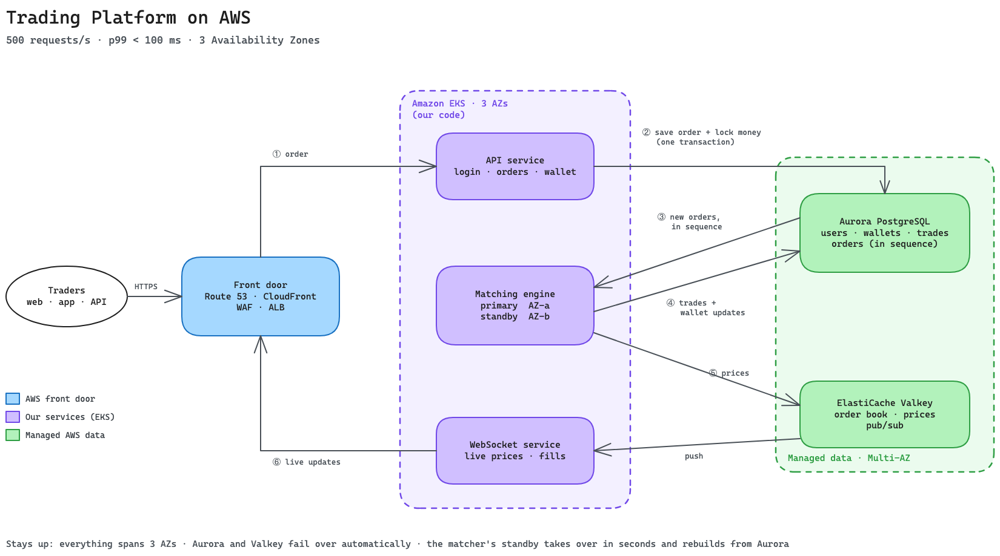

# Problem 1: Building castle in the cloud

The goal is a fast, highly available and cost-effective crypto trading platform on AWS, similar in spirit to Binance.

**Hard constraints:** AWS · 500 requests per second · p99 latency under 100 ms.

I keep a system design as simple as the requirements allow. 500 RPS does not need a large microservice mesh. Three core services on EKS, two managed data stores (Aurora and Valkey) and a managed edge layer, spread across three Availability Zones, handle it comfortably. Every extra component has to justify itself, which is why Kafka waits until it is needed (section 5).

## 1. Scope and features

A real exchange has dozens of subsystems. I focused on the ones that load the infrastructure and the latency budget:

- Spot trading (limit/market orders, cancellations): the latency-critical write path.
- Matching engine: stateful and strictly ordered. It is the hardest component to make highly available without split-brain or double fills.
- Wallets (balances, locking funds for open orders, trade settlement): money has to be 100% exact. A network retry cannot double-spend, and a crash cannot lose a cent.
- Live market data (prices, order book depth, fills via WebSocket): heavy read fan-out, pushed to traders in real time.
- Auth and accounts: hit on every private request, so it has to be fast.

Out of scope: on-chain deposits and withdrawals (blockchain nodes, hot/cold wallet management; Problem 5 covers their security), futures/margin trading, KYC document flows, back-office admin tools and offline analytics.

### The design choice that makes p99 &lt; 100 ms easy

`POST /order` **does not wait for the order to match.** It validates the request, locks the user's funds in the database, writes the order to the log and returns `202 Accepted` with an order ID. The fill notification reaches the user a moment later over WebSocket.

Binance supports an `ACK` mode like this (`newOrderRespType=ACK`), although its default waits for the fill. Making ACK-first the only mode decouples HTTP response time from matching and settlement, so the 100 ms budget covers only work we control on the request path.

I measure that p99 server-side with the ALB `TargetResponseTime` metric, because a trader's home Wi-Fi is outside our control.

## 2. Architecture




The main components:

- Traders (web, mobile, API bots): connect over HTTPS for REST calls and WSS for live streams.
- Front door (Route 53, CloudFront, WAF, ALB): DNS, TLS termination, DDoS protection and rate limiting, then routing of REST and WebSocket traffic into EKS.
- API service (EKS): stateless pods for login, order placement and wallet queries.
- Matching engine (EKS): holds the order book in memory, single-threaded per trading pair (symbol). A primary and a hot standby run in AZ-a and AZ-b, one each, and either can hold either role.
- WebSocket service (EKS): stateless pods that push order book updates and trade fills to connected traders.
- Aurora PostgreSQL (Multi-AZ): source of truth for users, wallets, orders and trades. At this scale the `orders` table is also the sequenced order log.
- ElastiCache Valkey (Multi-AZ): order book snapshots, latest prices, pub/sub channels and rate-limit counters. It is there for speed and fan-out and is never the source of truth for money.

The ALB sits in private subnets and connects to CloudFront through VPC origins. It has no public exposure, so nobody can bypass WAF and hit the origin directly. AWS added WebSocket support to CloudFront VPC origins in May 2026, so REST and WSS take the same path.

## 3. Walking through an order

1. Order arrives: a trader sends `POST /order` over HTTPS. CloudFront terminates TLS, WAF filters the request and the ALB routes it to an API pod. The pod verifies the JWT locally against cached public keys, increments a per-user rate-limit counter in Valkey and checks the order parameters.
2. Save and lock funds (single DB transaction): in one Aurora transaction, the API pod:
   - Moves the required funds from `available` to `locked` in the user's wallet, and fails the transaction if the balance is too low.
   - Takes the next per-symbol sequence number, as late as possible so the lock is held only briefly.
   - Inserts the order with that sequence number and a client-supplied `Idempotency-Key`. The key is unique per user, so a client that retries after a network blip does not place the order twice.

   Cancels go through the same path: a cancel is a sequenced row in the same per-symbol stream, so the primary and the standby see exactly the same inputs.

    Once the transaction commits, the API returns `202 Accepted`. If any step fails, the whole transaction rolls back.
3. Matcher picks up the order in sequence: the insert fires a Postgres `NOTIFY`. The matching engine is `LISTEN`ing on that channel, wakes up immediately and queries `WHERE symbol = $1 AND seq > last_seq ORDER BY seq`. A fallback poll every few milliseconds covers a dropped notification. `NOTIFY` only wakes the matcher; the sequence numbers in the table are the source of truth.
4. Match and settle (single DB transaction): the matcher runs the order against its in-memory book. It then writes the resulting trades, updates both traders' wallets (releasing locked funds and settling balances) and saves its new `last_seq` checkpoint in one transaction. Each trade gets a deterministic trade sequence number derived from the order sequence, so if a matcher crashes and re-runs the same order, the unique constraint prevents double settlement.
5. Push prices to Valkey: after the DB commit succeeds, the matcher updates the order book snapshot in Valkey and publishes price ticks and fills to Valkey pub/sub.
6. Fan out to traders: every WebSocket pod subscribes to those Valkey pub/sub channels. The pods broadcast price updates to everyone watching a symbol and route fill notifications to the traders involved. When a trader connects, the pod reads the latest snapshot from Valkey and then streams the live delta.

Standard Postgres `SERIAL` or `SEQUENCE` values can commit out of order under concurrency: transaction B (seq 11) might commit a millisecond before transaction A (seq 10). A matcher polling at that moment would see 11 and skip 10 forever. So step 2 takes its sequence number with `UPDATE symbol_seq SET seq = seq + 1 WHERE symbol = $1 RETURNING seq`. The row lock is held until commit, which gives strictly ordered, gap-free numbers per symbol. The cost is a single-row lock per trading pair, held until commit. That caps each symbol at roughly a few hundred orders per second (one over the lock-to-commit time), which is fine at 500 RPS in total and is the reason Kafka comes in at 10× (section 7).

## 4. Latency budget (server-side p99 for `POST /order`)

The budget fits inside 100 ms with room to spare:

- ALB to API pod: ~1-3 ms
- Local JWT verification, Valkey rate-limit check, input validation: ~1-3 ms
- Aurora transaction (insert order, lock funds, bump sequence, 4-of-6 quorum commit across 3 AZs): ~5-15 ms
- JSON serialization and HTTP response: ~1 ms
- Total server-side time: **~8-22 ms**

CloudFront and WAF add a couple of milliseconds at the edge, outside the ALB metric, so the end-to-end figure still has plenty of headroom. The k6 load test in staging (section 8) is what verifies these numbers.

## 5. Why these services (and what I passed on)

### Route 53 + CloudFront + WAF

Route 53 hosts the DNS, with the domain aliased to CloudFront. CloudFront terminates TLS close to users, includes AWS Shield Standard for free, runs WAF rate limits and managed rules at the edge, and keeps the ALB private through VPC origins.

- *What about Shield Advanced?* It costs $3,000/month with a one-year commitment. It is worth buying once the exchange attracts DDoS extortion groups (it is in the Problem 5 security plan), but it is more than day one needs.

### Application Load Balancer (ALB)

The ALB handles REST and WebSockets on one listener, integrates with EKS through the AWS Load Balancer Controller and supports weighted target groups for canary deployments. At 500 RPS it costs roughly $50/month.

- *Why not API Gateway?* Cost. 500 RPS sustained is ~1.3 billion requests a month, which comes out to ~$1,200/month on API Gateway HTTP APIs. CloudFront + WAF already sit in front and the API service handles auth, so API Gateway adds little for 20× the price.
- *Why not NLB?* We need L7 routing and weighted target groups for Argo Rollouts.

### Amazon EKS (across 3 AZs, with Karpenter and Graviton)

I chose EKS because the stateful matching engine needs careful placement: dedicated on-demand nodes, strict anti-affinity, `do-not-disrupt` rules and Kubernetes Lease-based leader election. For the stateless services, Karpenter + Graviton (`c7g`/`m7g`) gives good price-performance, and Argo CD + Argo Rollouts handle deployments. I have run this EKS + Karpenter + Argo stack in previous roles and know where it breaks.

- *Why not ECS on Fargate?* If the team did not already know Kubernetes, I would pick ECS for the stateless services, since it carries much less operational overhead. I kept EKS for fine-grained control over the matcher pods and native Argo Rollouts support.

### Aurora PostgreSQL (Multi-AZ)

User balances need multi-row ACID transactions. Aurora replicates storage 6 ways across 3 AZs, fails over cleanly, and provides `LISTEN/NOTIFY` and Aurora Global Database for cross-region DR.

- *Why not DynamoDB?* It scales horizontally very well, but `TransactWriteItems` is capped at 100 items, and ad-hoc financial reconciliation queries across a ledger are painful in DynamoDB compared to SQL.
- *Why not RDS Multi-AZ DB Cluster?* It is cheaper and a valid option, but it lacks Aurora Global Database for low-RPO cross-region DR.

### ElastiCache for Valkey (Multi-AZ)

Market data fan-out to WebSocket pods needs pub/sub, order book snapshots need sub-millisecond reads, and rate limiting needs atomic counters. Valkey is a drop-in Redis replacement, and AWS prices it noticeably lower on ElastiCache.

### Why no Kafka (MSK) on day one?

At 500 RPS, the sequenced `orders` table in Aurora is already a durable, ordered, replayable log. Adding Amazon MSK now would mean paying for 3+ brokers, running another stateful cluster and handling the dual-write problem between Aurora (where wallet funds are locked) and Kafka (where orders are queued). With everything in Aurora, locking funds and queuing the order happen in one atomic transaction. Kafka comes in with an outbox pattern at 5,000 RPS (section 7).

### A note on the matching engine design

The matcher follows the LMAX disruptor style: single-threaded per symbol, order book entirely in RAM, orders processed strictly in sequence. The matching logic is 100% deterministic, so the same sequence of orders always produces the same trades. That determinism is what lets the hot standby shadow the primary and take over. I did not store the live order book in Redis sorted sets, because matching needs multi-key reads and writes, and a cache should not hold the source of truth.

## 6. High availability and failure recovery

Every stateless service is sized for static stability across 3 AZs: if a whole Availability Zone goes dark, the remaining two AZs carry 100% of peak traffic immediately, without waiting for autoscaling. For example, if 4 API pods handle peak load, we run at least 6 pods (2 per AZ) using `topologySpreadConstraints`. During a real AZ outage everyone in the region competes for EC2 capacity at the same time, so survival should not depend on launching new nodes.

The primary matcher pod holds a Kubernetes `Lease`. The hot standby, in the other AZ, tails the same Aurora `orders` table and keeps an identical in-memory order book, but stops short of writing trades to the DB. Each leadership change increments an epoch number on the Lease, and the step ④ DB transaction checks it (fencing). If an old primary pod freezes and wakes up later, the database rejects its writes. Matcher pods also carry the annotation `karpenter.sh/do-not-disrupt: "true"`, and their NodePool sets `expireAfter: Never`, so Karpenter never removes a node from under an active matcher.

How the system handles each failure:

- A stateless pod crashes: the ALB readiness probe drops it within seconds, traffic goes to healthy pods, and kubelet restarts the container.
- A node or entire AZ goes down: the other two AZs already run enough spare pods to absorb the traffic immediately. Karpenter replaces the lost nodes in the background if needed.
- Primary matcher pod dies: its Kubernetes Lease expires after a few seconds. The hot standby sees the expired Lease, claims it, bumps the epoch and starts processing from the last committed `last_seq`. Kubernetes starts a new standby in the dead primary's AZ, the only other zone the matcher's node class allows, so primary and standby always end up in different AZs. If that whole AZ is down, the matcher runs without a standby until it recovers. I accept that trade-off at this scale; adding an AZ-c subnet to the node class would remove it.
- Both primary and standby matchers die at once: a fresh pod loads the last checkpoint and open orders from Aurora in sequence, rebuilds the in-memory book and resumes. At our volume a cold rebuild takes well under a minute.
- Aurora writer fails: Aurora promotes the reader instance in another AZ, which typically takes 30-60 seconds. During the switch, `POST /order` returns a retryable `503`, and clients retry safely with the same `Idempotency-Key`. The matcher pauses its loop and resumes once the new writer is live.
- Valkey primary fails: ElastiCache Multi-AZ promotes the replica automatically. The matcher pushes a fresh book snapshot, live WebSocket ticks pause for a few seconds, and no money or orders are lost. The API's rate limiter falls back to a per-pod in-memory limit during the switch, so order placement keeps working.
- Bad code deployment: Argo Rollouts watches Prometheus metrics during canary steps. If p99 latency spikes or 5xx errors cross 0.1%, it aborts the rollout and shifts traffic back to the stable version in ~1-2 minutes.

For disaster recovery (losing a whole AWS region), a warm standby runs in a second region: Aurora Global Database (cross-region storage replication with sub-second lag), a small baseline EKS cluster synced from the same Argo CD repo, a small Valkey cluster and a CloudFront VPC origin already defined for the DR region's private ALB. An exchange order book cannot run active-active across two regions without unacceptable latency, so regional failover is a deliberate human decision rather than an automated switch. If `us-east-1` is lost for good, we promote the secondary Aurora cluster, scale up the DR EKS nodes, let the matcher rebuild its book from Aurora and point the CloudFront distribution at the DR origin (a Terraform change that deploys in a few minutes; DNS doesn't change because users already resolve to CloudFront). That gives an **RPO of ~1 second** and an **RTO of ~15-30 minutes**.

## 7. Cost and scaling roadmap

### Where we start today (500 RPS)

500 RPS is modest. Most of it is market data reads served from Valkey and WebSocket broadcasts; order placements are a smaller share.

- API &amp; WebSocket services: 6 pods each (2 per AZ), with HPA scaling on CPU and active connections.
- Matching engine: 1 primary + 1 hot standby on dedicated `c7g` on-demand instances.
- Aurora PostgreSQL: 1 writer + 1 reader (`db.r7g.large`).
- ElastiCache Valkey: 1 primary + 1 replica (`cache.r7g.large`).

Ballpark monthly cost (us-east-1 on-demand pricing, single region, before DR or Shield Advanced):

- EKS control plane + EC2 nodes: ~$650
- Aurora (2 instances + storage/IO): ~$500
- ElastiCache Valkey (2 nodes): ~$260
- ALB, 3 NAT Gateways, CloudWatch/observability: ~$400
- CloudFront + WAF request fees (assuming 500 RPS 24/7): ~$2,100
- Total: **~$3,900 / month**, excluding CloudFront data transfer out, which grows with WebSocket market-data volume

CloudFront and WAF per-request fees are more than half the bill if traffic runs at 500 RPS around the clock. Real traffic comes in waves; if average traffic is a quarter of peak, the bill drops to about **~$2,300/month**. Spot instances for the stateless pods and Compute Savings Plans cut the EC2 portion further.

### Scaling to 10× (~5,000 RPS)

- Bring in Kafka (Amazon MSK) for the order log: at 5,000 RPS, the per-symbol sequence row lock in Postgres becomes a bottleneck. We switch to an outbox pattern: the API writes the order + wallet lock to Aurora, an outbox relay streams it to one `orders` Kafka topic keyed by symbol, and the matchers consume directly from Kafka.
- Shard the matching engine by trading pair: `BTC-USD` on one primary/standby pair, `ETH-USD` on another, and smaller pairs sharing shards.
- Add Aurora read replicas to take trade history and account queries off the writer.
- Enable cluster mode on Valkey to shard pub/sub and cache reads across multiple nodes.

### Scaling to 100× (~50,000+ RPS)

- Shard the wallet ledger by user ID: a single Aurora writer cannot handle 50k wallet updates a second, so we would shard the database by user, either at the application layer or with Aurora Limitless Database.
- Solve hot-account contention: big market makers trade on almost every tick, which turns their single wallet row into a lock bottleneck. We would split market-maker balances into multiple sub-buckets or batch-settle their net changes at the end of each matching window.
- Cell-based architecture: group users into self-contained stacks ("cells") so a failure in one cell affects only a fraction of the user base.
- Global edge with regional WebSocket termination: AWS Global Accelerator and regional WebSocket clusters give traders around the world fast local connections, while orders route back to the single home region where the matching engine runs. A single-threaded in-memory matcher per symbol can process tens of thousands of orders per second, so one symbol's order book still does not need to be distributed.

## 8. How I'd build, ship, and operate it

- Infrastructure as code: everything lives in modular Terraform (`vpc`, `eks`, `karpenter`, `aurora`, `valkey`, `edge`) with separate state roots per environment and region. S3 native state locking (`use_lockfile = true`, added in Terraform 1.10) removes the need for a DynamoDB lock table. PRs run `terraform fmt`, `validate`, Checkov security scans, and post the `plan` output to the PR. Merges to `main` require approval before applying to prod, and a scheduled nightly `plan` catches manual drift.
- CI/CD &amp; progressive delivery: GitHub Actions authenticates to AWS with short-lived OIDC tokens (no static AWS keys stored in GitHub), builds `arm64` container images and pushes them to ECR with vulnerability scanning enabled. Argo CD syncs changes into the cluster, and Argo Rollouts steps new API/WebSocket releases through 10% → 30% → 60% traffic weights on the ALB, checking Prometheus metrics (p99 &lt; 100 ms, 5xx &lt; 0.1%) at each step before promoting.
- Zero-downtime matcher upgrades: a singleton matching engine cannot be canaried, because two versions cannot own the same order book at once. We deploy the new version to the standby pod first, let it catch up on the order stream, verify that its in-memory book state hash matches the primary's, trigger a clean Lease handover (~1-2 seconds) and then upgrade the old primary. Rotating the underlying EC2 nodes uses the same procedure.
- Karpenter configuration: nodes are split into two pools. The `general` pool runs Spot + on-demand `arm64` instances with aggressive consolidation for stateless pods, on the `default` node class across all 3 AZs. The locked-down `matching-engine` pool provisions only dedicated on-demand `c7g` instances in AZ-a and AZ-b and never auto-evicts pods. The `EC2NodeClass` decides *where and how* a node is launched (subnets, and therefore AZs, plus AMI, IAM role, security groups and disk). The `NodePool` decides *what* is launched and when it may be removed:
  ```yaml
  apiVersion: karpenter.sh/v1
  kind: NodePool
  metadata:
    name: matching-engine
  spec:
    template:
      spec:
        nodeClassRef:
          group: karpenter.k8s.aws
          kind: EC2NodeClass
          name: matching-engine
        taints:
          - key: workload
            value: matching-engine
            effect: NoSchedule
        expireAfter: Never # We rotate matcher nodes manually via standby handover
        requirements:
          - key: karpenter.sh/capacity-type
            operator: In
            values: ["on-demand"]
          - key: karpenter.k8s.aws/instance-family
            operator: In
            values: ["c7g"]
          - key: topology.kubernetes.io/zone # matches the two subnets below
            operator: In
            values: ["us-east-1a", "us-east-1b"]
    disruption:
      consolidationPolicy: WhenEmpty
      consolidateAfter: 1h
  ---
  apiVersion: karpenter.k8s.aws/v1
  kind: EC2NodeClass
  metadata:
    name: matching-engine
  spec:
    role: KarpenterNodeRole-trading-prod # node IAM role, created by Terraform
    amiSelectorTerms:
      - alias: bottlerocket@v1.40.0 # example version; pinned so a new AMI never drifts a matcher node
    # Only the private app subnets in AZ-a and AZ-b, so matcher nodes can only launch in those two zones
    subnetSelectorTerms:
      - tags:
          karpenter.sh/discovery: trading-prod
          tier: private-app
          topology.kubernetes.io/zone: us-east-1a
      - tags:
          karpenter.sh/discovery: trading-prod
          tier: private-app
          topology.kubernetes.io/zone: us-east-1b
    securityGroupSelectorTerms:
      - tags:
          karpenter.sh/discovery: trading-prod
    metadataOptions:
      httpTokens: required # IMDSv2 only
      httpPutResponseHopLimit: 1 # pods can't reach the node's instance role
    blockDeviceMappings:
      - deviceName: /dev/xvdb # Bottlerocket data volume
        ebs:
          volumeSize: 50Gi
          volumeType: gp3
          encrypted: true
    tags:
      workload: matching-engine
  ```
  The subnet terms select by tag, so Terraform tags each private subnet with its zone (`topology.kubernetes.io/zone`) as well as `tier`. The matcher's two pods land one per AZ: they select this pool, tolerate its taint and spread across zones with `whenUnsatisfiable: DoNotSchedule`. Only the zones this pool allows count, which leaves exactly one pod in AZ-a and one in AZ-b. Whichever pod holds the Lease is the primary.
  ```yaml
  # Matching engine StatefulSet (excerpt). updateStrategy OnDelete: the controller
  # never restarts a matcher itself; upgrades follow the handover procedure above.
  spec:
    replicas: 2 # Lease holder = primary, the other = hot standby
    updateStrategy:
      type: OnDelete
    template:
      metadata:
        labels:
          app: matching-engine
        annotations:
          karpenter.sh/do-not-disrupt: "true"
      spec:
        nodeSelector:
          karpenter.sh/nodepool: matching-engine
        tolerations:
          - key: workload
            value: matching-engine
            effect: NoSchedule
        topologySpreadConstraints:
          - maxSkew: 1
            topologyKey: topology.kubernetes.io/zone
            whenUnsatisfiable: DoNotSchedule
            labelSelector:
              matchLabels:
                app: matching-engine
  ```
- Alerting that doesn't burn out on-call: we track a 99.95% availability SLO and a p99 &lt; 100 ms latency SLO with multi-window, multi-burn-rate alerts in Prometheus, so on-call is paged only when the error budget is burning fast, not on a 10-second blip. Beyond infra metrics, we page on business invariants: matcher sequence lag (`max(seq) - last_seq`), standby lag, and a background reconciler that checks wallet balances against the sum of trades.
- Load tests and game days:
  - k6 load testing: before major changes ship, k6 runs a realistic traffic mix in staging at 500 RPS and 1,000 RPS (2×). If server-side p99 hits 100 ms, the pipeline fails.
  - Quarterly chaos game days: AWS Fault Injection Service (FIS) simulates real outages (blackholing an AZ's subnets, killing a matcher node, forcing an Aurora failover) in staging and then prod. A CloudWatch SLO alarm aborts the test automatically if latency or errors breach safe thresholds.
- Baseline security: all workloads run in private subnets with VPC endpoints for AWS services, KMS encryption at rest, TLS everywhere in transit, Secrets Manager with rotation, EKS Pod Identity for least-privilege IAM, and GuardDuty + CloudTrail watching the account. [Problem 5](../problem5/SOLUTION.md) covers how I would harden this against real exchange threats.
