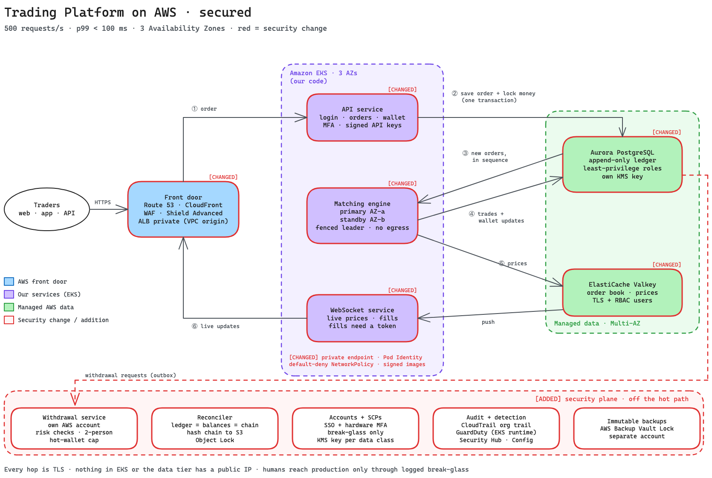

# Problem 5: Fortify the castle

This document takes the crypto spot trading exchange from [Problem 1](../problem1/solution.md) (AWS, 500 RPS, p99 < 100 ms) and hardens it for production.

I walked the same request flow (① to ⑥) and built the controls into each step instead of adding a compliance checklist at the end. Every item is tagged so the changes against Problem 1 are easy to find:

- [CHANGED]: a Problem 1 component whose setup or behavior I modified for security.
- [ADDED]: a new security control or component.
- [ACCEPTED RISK]: something I chose *not* to build yet, with the reason and what would trigger adding it later.

An exchange is a bank with a public API and irreversible transactions. When you hold customer crypto, the priorities are:
1. Money cannot leave the platform without strict, independent controls.
2. The internal ledger cannot be silently altered (by attackers, bugs, or our own engineers).
3. Customer accounts cannot be easily hijacked.
4. No human, including me, has standing write access to production.

Availability and privacy come next. **Heavy security checks stay off the hot trading path**, so the `< 100 ms` p99 latency budget holds.

## 1. Updated architecture

In the diagram:
- Red outlines (`[CHANGED]`): Problem 1 components that were hardened.
- Red band at the bottom (`[ADDED]`): new security and custody components. **None of them sit on the synchronous order path (① to ⑥)**, so order latency is unaffected.
- The 3-AZ EKS + Aurora + Valkey design is unchanged. The controls fit into it.

## 2. Threat model

### What we're protecting, in order of importance
1. Customer funds and ledger integrity: on-chain hot/cold wallets and the balances and trades in Aurora.
2. User credentials and trading keys: passwords, MFA seeds, session tokens, and bot API keys.
3. Order book fairness: nobody can inject fake orders, tamper with sequencing, or cause split-brain double fills.
4. Customer PII: identity data and KYC status.
5. Platform availability: an outage during a large Bitcoin price swing costs user trust and draws regulator scrutiny.

### Who we're defending against
Organized crypto theft groups (including state-sponsored actors such as Lazarus), credential-stuffing bots, DDoS extortionists, rogue or phished insiders (engineers, support staff, DBAs), and software supply-chain attacks through compromised npm packages, GitHub Actions, or container images.

### Top threats and where we stop them

| Threat | Primary defense (and where it's covered) |
|---|---|
| Theft via compromised withdrawals | Isolated `prod-custody` account, independent outbox verifier, velocity caps, hot-wallet limits (Section 3.7) |
| Account takeover (phishing, SIM swap, credential stuffing) | WebAuthn passkeys / TOTP (never SMS), step-up auth, 24h withdrawal freeze after security changes (Section 3.2) |
| Leaked or abused trading API keys | Signed requests (Ed25519 / HMAC), key scopes (`withdraw` off by default), mandatory IP allowlists (Section 3.2) |
| Silent ledger tampering or balance bugs | Append-only double-entry ledger, DB `CHECK` constraints, per-service DB roles, out-of-band Reconciler + hash chain (Section 3.4) |
| Insider threat / compromised engineer laptop | Zero standing prod access, two-person break-glass, maker-checker admin flows, immutable backups (Sections 3.4, 3.6) |
| DDoS & L7 traffic floods | CloudFront + WAF rate limits, private VPC origin, AWS Shield Advanced (Section 3.1) |
| Supply-chain compromise | SHA-pinned Actions, scoped OIDC, Cosign image signing verified by Kyverno at admission (Section 3.5) |
| Pod compromise & lateral movement | Default-deny NetworkPolicies (no internet egress on matcher), one Pod Identity role per service, GuardDuty runtime monitoring (Section 3.3) |

## 3. Security along the request path

### 3.1 Front door: Route 53, CloudFront, WAF, ALB

- [CHANGED] Private origin, locked end to end:
  - In Problem 1 the ALB sits in private subnets behind a CloudFront VPC origin ([AWS docs][vpcorigin]), which has supported WebSockets since May 2026 ([announcement][vpcws]).
  - Here the ALB's security group accepts traffic *only* from the CloudFront VPC-origin security group. Nothing else inside the VPC can reach the ALB directly.
  - The ALB forwards to pods over HTTPS, so traffic stays encrypted on every hop, including ALB to pod.
- [CHANGED] CloudFront WAF web ACL (Problem 1 already runs WAF rate limits and managed rules; this is the full rule set):
  - AWS Managed Rules (Core, Known Bad Inputs, SQLi, IP Reputation) plus strict per-IP rate limits on `/login`, `/register`, and `/password-reset`.
  - AWS WAF Bot Control on human web routes (`/login`, `/register`). Bot Control stays off the trading API routes, where algorithmic trading bots are paying customers.
  - Geo-blocking for sanctioned jurisdictions.
  - `AWSManagedRulesCommonRuleSet` can block WebSocket upgrade handshakes on `/ws` with a `403`. I don't exempt `/ws` from the rule group. Instead I set only the sub-rule that misfires to Count and add a rule that blocks on that sub-rule's label for every path except `/ws`. Rate limits and all other rules still apply to `/ws`.
- [ADDED] AWS Shield Advanced (decision: turn it on in the first 30-90 days, before large marketing pushes):
  - Shield Advanced costs $3,000/month on a 1-year commitment ([pricing][shield]). That buys direct access to the AWS Shield Response Team (SRT), automatic L7 DDoS mitigation, and bill spike protection if an attack drives up our CloudFront/ALB costs.
  - Crypto exchanges get DDoS ransom demands constantly, and one hour of downtime in a volatile market costs far more than $36k/year. Shield Standard + WAF rate limits are enough for day-0 launch, and we turn on Shield Advanced in the first 30-90 days, before large marketing pushes make us a target.
- [ADDED] Strict TLS 1.2+, HSTS preload, and Route 53 DNSSEC: blocks protocol downgrades and DNS cache poisoning or hijacking.
- [ACCEPTED RISK] CloudFront terminates TLS at the edge: WAF has to decrypt traffic to inspect HTTP payloads, and CloudFront re-encrypts it on the hop to the ALB. AWS already runs the whole infrastructure, so trusting CloudFront at the edge is a standard trade-off.

### 3.2 API service: ① login, orders, and wallets

- [ADDED] MFA required for withdrawals and API keys, with passkeys as the phishing-resistant default:
  - Passkeys (WebAuthn/FIDO2) are the default prompt. TOTP authenticator apps remain as a fallback, but TOTP codes can be phished, so they are not the strong option.
  - Creating an API key with the `withdraw` scope, or adding that scope to an existing key, requires a passkey. TOTP alone is not accepted.
  - **No SMS 2FA.** SIM swapping against crypto holders is too easy. SMS and email are used only for out-of-band alerts.
- [ADDED] Step-up auth and 24-hour cooling-off locks:
  - Adding a withdrawal address, resetting a password, changing MFA, or creating an API key requires fresh step-up authentication.
  - A password or MFA reset, or a new withdrawal address, triggers an automatic 24-hour withdrawal freeze (or address activation delay) and alerts the user with a one-click *"Freeze my account"* link. An attacker who steals a session cookie cannot drain the account right away.
- [CHANGED] Short-lived, device-bound sessions:
  - Access JWTs expire after 15 minutes. Refresh tokens rotate on every use, live in `HttpOnly; Secure; SameSite=Strict` cookies for web users, and are bound to a client device key (DPoP-style), so a stolen token can't be replayed from another machine.
  - Active sessions are tracked in Valkey/Aurora, so *"Log out everywhere"* or a support agent freezing an account cuts off access within seconds (Valkey invalidation), and at most after the 15-minute access-token lifetime.
- [ADDED] Signed API requests for bots:
  - Every API request carries a timestamp, a `recvWindow` to block replays, and a signature over the HTTP method, path, and body.
  - We support HMAC-SHA256 for compatibility with existing Binance-style trading bots, with secrets envelope-encrypted via KMS. New API keys default to Ed25519 asymmetric keys, so we store only the user's *public* key and a database read leak cannot forge a trade.
- [ADDED] Scoped API keys and mandatory IP allowlists for withdrawals:
  - API keys have explicit scopes: `read`, `trade`, and `withdraw`.
  - **`withdraw` is disabled by default and cannot be enabled until the user configures a static IP allowlist** on the key. Un-allowlisted `trade` keys expire automatically after 90 days.
- [CHANGED] Strict input schemas and parameterized SQL (Problem 1 validates input; this makes the rules explicit):
  - Trading pairs are checked against an in-memory allowlist. Prices and quantities must match decimal tick sizes and min/max bounds before anything touches the DB. All SQL queries are parameterized, with WAF as a second layer.
- [ACCEPTED RISK] No client-side mTLS certificates for API traders yet: running a client PKI for retail users is painful, and Ed25519 request signing plus IP allowlists already stop stolen keys from being used elsewhere. *Trigger to revisit:* onboarding the first institutional market maker that asks for mTLS.

### 3.3 EKS: API, matching engine, and WebSocket pods

- [ADDED] Private-only EKS API endpoint:
  - The Kubernetes control plane has no public endpoint. GitHub Actions never talks to EKS: it pushes images to ECR, and Argo CD inside the cluster pulls changes from Git. Engineers authenticate through AWS IAM Identity Center (SSO) from inside the network, with **no `kubectl exec` allowed in production namespaces** outside a logged break-glass session.
- [CHANGED] EKS Pod Identity, one least-privilege IAM role per service (Problem 1 already uses Pod Identity): no shared node IAM roles and zero static AWS credentials.
- [ADDED] Default-deny Kubernetes `NetworkPolicy` (ingress and egress):
  - Every pod's egress still allows CoreDNS and the EKS Pod Identity Agent on its node. Without them, name lookups and AWS credential requests would fail.
  - API pods can also reach Aurora and Valkey, plus external KYC/notification webhooks through controlled egress.
  - WebSocket pods can also reach Valkey and nothing else. They have no network route or credentials for Aurora.
  - **The matching engine has zero internet egress.** Beyond DNS and the Pod Identity Agent, it can reach only Aurora, Valkey, and the Kubernetes API server, which it needs to renew its leader Lease.
- [ADDED] Pod Security Admission (`restricted`) and Kyverno policies: containers run as non-root with read-only root filesystems and dropped Linux capabilities, and Kyverno blocks any image that isn't pinned by SHA256 digest and signed by our CI pipeline via `cosign`.
- [CHANGED] Locked-down Lease for matcher fencing:
  - Problem 1 already fences the matcher in the database: each leadership change bumps an epoch on the Kubernetes Lease, and the step ④ transaction rejects writes from an older epoch. That check stays as it is.
  - The gap is the Lease itself. Any workload that can edit it can bump the epoch and take over leadership. Here, Kubernetes RBAC lets *only* the `matching-engine` ServiceAccount update its Lease object.
- [ADDED] Amazon GuardDuty EKS Runtime Monitoring: watches container syscalls for reverse shells, crypto miners, and credential scraping. At first it pages on-call. Once tuned over the first 30 days, a high-confidence finding labels the pod automatically and a quarantine `NetworkPolicy` cuts its network access.
- [ACCEPTED RISK] Single prod EKS cluster and no service mesh (Istio/Linkerd): a sidecar mesh adds ~1-3 ms of latency per hop and significant operational complexity. Namespace isolation, dedicated matcher nodes, VPC CNI NetworkPolicies, and per-pod IAM roles cover our needs at 3 services. *Trigger to revisit:* growing past ~10 microservices, or an auditor requiring mutual TLS between pods.

### 3.4 Aurora PostgreSQL: ② order lock, ③ sequence read, ④ settlement

If an attacker or a bug corrupts the database, the exchange is insolvent, so this layer gets the strongest internal guardrails:

- [CHANGED] Append-only, double-entry financial ledger:
  - Every balance change writes a balanced pair of rows to an append-only `ledger_entries` table (`SUM(debit) == SUM(credit)` per transaction), instead of running `UPDATE wallets SET available = ...` in isolation.
  - `UPDATE`, `DELETE`, and `TRUNCATE` permissions on `ledger_entries` and `trades` are revoked from all application DB users and blocked by a database trigger. To fix an accounting issue, an admin inserts a compensating ledger entry through a two-person maker-checker flow.
- [ADDED] Hard database `CHECK` constraints: the wallet table enforces `CHECK (available >= 0 AND locked >= 0)`. If a developer ships a rounding bug in the API or matcher, Postgres aborts any transaction that would take a balance below zero.
- [ADDED] Strict per-service Postgres roles (separation of duties):

  | Postgres role | Allowed to do | Forbidden from doing |
  |---|---|---|
  | `api_svc` | `INSERT` new orders; call the `lock_funds()` stored procedure; call `request_withdrawal()`, a `SECURITY DEFINER` function that locks the funds and inserts a `withdrawal_outbox` row in the same transaction (insert only) | Writing trades, settling balances, or updating, approving, or deleting withdrawal requests |
  | `matcher_svc` | `SELECT` open orders; `INSERT` trades and settlement ledger entries | Creating new orders or initiating withdrawals |
  | `withdraw_svc` | Read ledger/balances; read `withdrawal_outbox` and update each request's status | Creating withdrawal requests, placing orders, or writing trade fills |

  The WebSocket service has no Postgres role at all, so it cannot read or write anything in Aurora.

  **Even with an RCE in the public-facing API pod, the `api_svc` database role cannot fabricate a trade or credit a user's balance**, and the matcher cannot invent orders.
- [ADDED] IAM database authentication (no static DB passwords in pods):
  - Pods generate short-lived 15-minute RDS auth tokens with their EKS Pod Identity role.
  - Our services pool connections, so the IAM check runs only when a connection is first opened and adds 0 ms to individual queries ([AWS docs][iamdb]). It does use ~300-1,000 MiB of extra RAM on Aurora, and IAM DB logins don't appear in CloudTrail, so we turn on the Postgres `log_connections` and `log_disconnections` settings.
- [CHANGED] Custom Secrets Manager rotation for the Aurora master password:
  - Aurora's built-in "manage master password in Secrets Manager" option **is not supported on Aurora Global Database clusters** ([AWS docs][smaurora]), which we rely on for cross-region DR. We deploy the standard Secrets Manager rotation Lambda instead and restrict read access on that secret to the break-glass role.
- [ADDED] Out-of-band Reconciler service (off the hot path):
  - Runs every 60 seconds against the Aurora reader replica and checks three invariants:
    1. Every user's wallet balance equals the exact sum of their `ledger_entries`.
    2. Every user's `locked` balance equals the exact sum of their open orders.
    3. Total user liabilities across the exchange do not exceed our known on-chain wallet holdings.
  - If any check fails, it pages on-call and **flips the global kill switch to halt all withdrawals automatically.**
- [ADDED] Hourly tamper-evident ledger hash chain (within 30-90 days):
  - A rogue engineer with break-glass DB superuser access could bypass the triggers and rewrite a balance row. To catch that, the Reconciler extends a SHA-256 hash chain over the new `ledger_entries` rows every hour. It signs the latest hash with a KMS asymmetric signing key that lives in the Security account, and writes the signed hash to an S3 bucket with Object Lock (Compliance mode) in that same account. Not even the AWS root user can rewrite that object.
  - The hourly run only covers new rows. A separate weekly job recomputes the whole chain from the first entry and compares it with the stored signed hashes, so an edit to an old row is caught too.

### 3.5 CI/CD and supply chain: Terraform, GitHub Actions, ECR, Argo CD

- [CHANGED] Locked-down GitHub OIDC trust policies:
  - Production image pushes and Terraform applies run in a GitHub Environment named `production`. A job that uses an Environment gets the OIDC claim `sub = repo:ORG/REPO:environment:production`, and the IAM trust policy accepts only that exact `sub`, with `aud` pinned to `sts.amazonaws.com`.
  - The `production` Environment has a deployment-branch rule that allows only `main`, so no other branch can assume the production role.
- [ADDED] End-to-end supply chain verification:
  - Third-party GitHub Actions are pinned by full 40-char commit SHA.
  - A branch ruleset on `main` requires 2 approvals, including a code owner. `CODEOWNERS` assigns owners to `.github/workflows/`, `terraform/`, `Dockerfile`, and database migrations, so changes there always need one of them.
  - ECR tags are immutable, Amazon Inspector scans images on push, and GitHub Actions signs every container image with Sigstore Cosign (keyless OIDC). Kyverno in EKS verifies that signature before a pod can start.
- [CHANGED] Hardened Argo CD and Terraform state: Argo CD has its local `admin` user disabled (SSO only, RBAC scoped per project), and Terraform runs only from CI against encrypted S3 state in the shared-services account.

### 3.6 Valkey, WebSockets, AWS account structure, and operations

- [CHANGED] Valkey encryption and RBAC: TLS in transit, KMS encryption at rest, and ElastiCache role-based access control (RBAC) ([AWS docs][rbac]) with the `default` user disabled:
  - The `matcher` user can write `book:*` and `price:*` and publish to channels.
  - The `websocket` user is read-only plus `SUBSCRIBE`.
  - The `api` user can read and write only `ratelimit:*`, `session:*`, and `listenkey:*`.
- [ACCEPTED RISK] Valkey is never trusted for financial truth. It holds market data snapshots, pub/sub, rate limits, session state, and `listenKey` tokens, but every balance change goes through Aurora, so a compromised Valkey **cannot move money or forge a balance.** It is not harmless, though. Session revocation and access to private WebSocket streams depend on Valkey, so an attacker with write access could delay a revocation or read another user's order fills. That is why Valkey gets TLS, RBAC, and no `default` user, and why I don't add more than that.
- [ADDED] Ephemeral `listenKey` tokens for private WebSocket streams: public price feeds stay anonymous. Subscribing to private order fill streams requires exchanging an authenticated REST call for a short-lived, single-use WebSocket token, and `Origin` header validation stops cross-site WebSocket hijacking (CSWSH).
- [ADDED] Multi-account AWS Organization with service control policies (SCPs):
  - Workloads are split across dedicated accounts: Management, Security / Log Archive, Shared Services (ECR, Terraform state), Prod-Trading (EKS, Aurora, Valkey), Prod-Custody (isolated withdrawal signing), Backup (air-gapped vault), and Staging.
  - Org-wide SCPs block anyone, account admins included, from disabling CloudTrail or GuardDuty, leaving the AWS Organization, creating static IAM user access keys, running resources in unapproved regions, making S3 buckets or RDS snapshots public, or calling `kms:ScheduleKeyDeletion`.
  - SCPs do not apply to the management account itself. It therefore runs no workloads, and only break-glass users can sign in to it.
- [ADDED] Zero standing human write access to production:
  - Engineers sign in through AWS IAM Identity Center with hardware FIDO2 security keys (YubiKeys).
  - Everyday access to `prod-trading` is read-only (metrics, logs, read-only Argo CD UI).
  - To change production during an incident, an engineer requests a time-boxed break-glass role. A second engineer must approve it, the request pages the `#security-alerts` channel at high priority, and every command is logged to the immutable Security account.
- [ADDED] Audit and detection in the Security account: an organization-wide CloudTrail trail writes to an Object Lock S3 bucket there, AWS Config records configuration changes in every account, and Security Hub collects GuardDuty, Inspector, and Config findings in one place for on-call.
- [CHANGED] Separate KMS customer managed keys (CMKs) per data class (Problem 1 already encrypts at rest with KMS): one key each for Aurora, Valkey, API HMAC secrets, and backups, each with a key policy limited to the exact IAM role that needs it.
- [ADDED] Cross-account immutable backups (ransomware and rogue-admin protection):
  - **Aurora Global Database is for high availability, not backup.** If someone runs `DROP TABLE ledger_entries;`, Global Database replicates the deletion to the DR region in under a second.
  - AWS Backup copies Aurora snapshots across accounts into the dedicated Backup account, inside a vault with Vault Lock in Compliance mode ([AWS docs][vaultlock]). Once locked, not even the account root user can delete those backups before their retention period ends.
- [ADDED] Emergency kill switches (database/feature flags, no deploy required):
  - One-command switches to (1) halt all withdrawals globally, (2) pause trading on one symbol or exchange-wide, and (3) revoke all active user sessions and API keys.

### 3.7 What Problem 1 left out of scope: withdrawals, KYC, admin

Problem 1 left crypto withdrawals, KYC, and the admin back office out of scope to focus on the matching engine. A security design can't skip them, because withdrawals and admin tools are where many of the largest crypto exchange hacks have happened:

1. [ADDED] Isolated withdrawal and custody architecture (`prod-custody` account):
   - When a user requests a withdrawal in `prod-trading`, the API verifies their passkey/TOTP, checks their 24h cooling-off status and IP allowlist, then calls `request_withdrawal()`, which locks the funds and writes the request to the `withdrawal_outbox` table in one transaction.
   - The Withdrawal Service runs in a separate `prod-custody` AWS account and reads pending requests from the trading Aurora cluster over AWS PrivateLink, using the `withdraw_svc` role. It re-checks that the user's ledger history is clean and the destination address has passed its activation delay.
   - That re-check reads data the trading account controls, so on its own it does not stop an attacker who owns `prod-trading`. The real independence comes from two controls the trading account cannot change: per-user and global hourly outflow velocity caps enforced in `prod-custody` (a configured ceiling on value leaving the exchange per hour), and the policy on the MPC signer described below.
   - Withdrawals over a set dollar threshold wait for manual two-person (maker-checker) approval.
   - Hot wallet cap: only <5% of customer funds sit in the automated hot wallet, which is backed by an MPC custody provider or HSM that enforces velocity and allowlist rules at the cryptographic signer level. The other 95%+ stays in offline cold storage with a qualified custodian.
2. [ADDED] Minimal-footprint KYC: we never store raw passport photos or driver's licenses in our own S3 buckets. The frontend uploads documents directly to a KYC vendor (such as Sumsub or Persona), and our database stores only the verification status (`VERIFIED`/`REJECTED`) and an external reference ID, so there are no document files for us to leak.
3. [ADDED] Locked-down admin back office: internal support and ops tools sit behind AWS Verified Access (a zero-trust proxy requiring corporate SSO and a hardware YubiKey) and are never exposed to the public internet. Support agents see masked PII by default. Any manual balance credit or adjustment requires maker-checker approval (one person proposes, a second independent person approves) and writes an auditable compensating entry to the ledger.

## 4. Rollout priorities: Day 0 vs. Day 30-90 vs. deferred

Not everything can ship before launch. This is where I draw the line.

### Won't launch without (Day-0 blockers)
If any of these isn't ready, we delay launch or launch with crypto withdrawals turned off:
1. Isolated withdrawal pipeline: separate `prod-custody` account, <5% hot wallet cap, address cooling-off delays, global hourly outflow velocity limits, two-person approval for large withdrawals, and a tested halt-withdrawals kill switch.
2. Database ledger guardrails: append-only double-entry ledger, `CHECK (available >= 0)` constraints, separate per-service Postgres roles (`api_svc` vs `matcher_svc`), and the 60-second Reconciler wired to halt withdrawals automatically on mismatch.
3. Account and API key protections: mandatory passkey/TOTP for withdrawals (no SMS), 24h withdrawal freeze on credential changes, signed API requests, and the `withdraw` key scope disabled by default and tied to an IP allowlist.
4. Zero standing prod access: multi-account AWS Organization with baseline SCPs, IAM Identity Center with hardware MFA, private EKS endpoint, and logged break-glass roles.
5. Edge and network isolation: private ALB behind CloudFront VPC origin, WAF managed and rate-limit rules, default-deny Kubernetes `NetworkPolicies` (no internet egress on matcher), and KMS encryption per data class.
6. Immutable audit logs and backups: org-wide CloudTrail to an Object-Locked S3 bucket in the Security account, GuardDuty paging on-call, and cross-account AWS Backup with Vault Lock (Compliance mode).
7. Supply chain and IR basics: scoped GitHub OIDC, digest-pinned Cosign-signed images verified by Kyverno, Pod Security `restricted`, and a pre-launch tabletop incident drill.

### Fast follow (first 30-90 days after launch)
- AWS Shield Advanced ($3k/mo): turn it on before large marketing pushes make us a target.
- Hourly ledger hash chain anchored to S3 Object Lock: closes the remaining "rogue DBA with break-glass superuser" tamper path.
- AWS Network Firewall for domain-allowlisted egress: `NetworkPolicies` already block matcher internet egress on day 0; this restricts the API pods' outbound webhook calls by domain name.
- WAF Bot Control tuning and automatic GuardDuty pod quarantine: both need a few weeks of baseline production traffic so false positives don't lock out real users or kill healthy pods.
- External penetration test and private bug bounty program: most useful once the core system is stable.
- DR region security failover drill: proves that KMS keys, IAM roles, WAF, and SCPs work when running from the backup region.

### Consciously deferred, with the trigger for each

| Deferred control | Why we skip it now | Trigger to build it |
|---|---|---|
| Service mesh (Istio / Linkerd mTLS) | Adds ~1-3 ms latency per hop and heavy ops overhead for just 3 services | Growing past ~10 microservices, multi-tenant clusters, or a hard regulator mandate |
| Client mTLS certificates for API bots | High onboarding friction for retail traders; Ed25519 signing + IP allowlists cover it | Signing our first institutional market-maker SLA |
| Aurora Database Activity Streams | Expensive streaming overhead; Postgres connection logging + zero standing access covers day 0 | Entering our formal SOC 2 Type II audit window |
| Cryptographic proof of reserves (Merkle tree) | Builds public trust but doesn't stop an active hack | Regulator requirement or customer demand as AUM grows |
| Dedicated SIEM / 24×7 MDR vendor | Security Hub + GuardDuty paging on-call fits a small team | Hiring our first dedicated security engineer or log volume outgrowing Security Hub |
| Amazon Macie | We don't store KYC documents in S3 | If business requirements ever force us to hold PII files in our own buckets |

## 5. Does the security work break the < 100 ms p99 budget?

No. Every heavy check (reconciliation, hash chaining, withdrawal verification, runtime scanning) runs **off the synchronous order path**.

The controls that *do* sit on the `POST /order` hot path add the following, on top of Problem 1's ~8-22 ms baseline:

| Hot-path security control | Added p99 latency | Why it's small |
|---|---|---|
| API signature verification (Ed25519 / HMAC) | < 0.1 ms | Pure CPU work in Go/Rust/Node |
| Session / API key scope and IP check | ~0.5 ms | Cached in memory on the API pod with a short TTL and Valkey invalidation |
| Aurora IAM DB authentication | 0 ms per query | Checked only when the connection pool opens a new TCP connection |
| Valkey TLS + RBAC check | ~0.1-0.3 ms | Persistent pooled connections amortize the TLS handshake |
| EKS NetworkPolicies (AWS VPC CNI eBPF) | ~0 ms | Enforced in kernel space via eBPF |
| **Total added server-side overhead** | **< 1 ms** | **Server-side p99 stays ~9-23 ms, well under the 100 ms limit** |

Two items sit outside that server-side total:
- Edge: the extra WAF rules add < 1 ms at CloudFront, and the private VPC origin adds ~0 ms because it is the same CloudFront-to-ALB hop. Like Problem 1's edge cost, this falls outside the ALB metric.
- Matcher fencing: the epoch check already ran inside Problem 1's step ④ transaction, after the API has returned `202`, so it is off the order-acknowledgement path. Locking down the Lease with RBAC adds nothing to any request.

## 6. Unknowns: what I'd ask the team on day 1, and what I assumed

These are the people I'd ask and the assumptions this design makes:

| Open question | Who I'd ask | What I assumed for this document |
|---|---|---|
| Target licensing and regulator (MAS in Singapore, VARA in Dubai, MiCA in EU?) | Founders & Legal Counsel | A regulated jurisdiction expecting SOC 2 / ISO 27001 controls, segregated customer funds, and FATF Travel Rule support |
| Crypto custody stack (MPC vendor like Fireblocks, CloudHSM, or qualified custodian?) | CEO, CTO & Finance | Hot wallet (<5% of assets) via an MPC provider enforcing policy at the signer; 95%+ in cold storage with a qualified custodian |
| Fiat on-ramp / PCI DSS scope | Product & Payments lead | Out of PCI scope: card and bank transfers go through a third-party hosted checkout, and card numbers never touch our servers |
| Team size and on-call rotation | VP of Engineering | Lean engineering team with no dedicated 24×7 SOC yet, so alerts must be high-signal (GuardDuty + Reconciler paging on-call) |
| Withdrawal auto-approval ceiling | Finance & Risk team | Placeholder of $10,000 equivalent per withdrawal before requiring two-person manual approval, plus a global hourly outflow circuit breaker |

## 7. Trade-offs I accepted

- User friction for safety: required passkeys/TOTP, a 24-hour withdrawal wait after a password reset, and IP allowlists on withdrawal API keys will annoy some impatient users. With irreversible crypto assets, preventing account drain takes priority over frictionless withdrawals.
- Fixed monthly costs early for tail-risk protection: Shield Advanced ($3k/mo) and a multi-account AWS Backup vault don't make the app faster at 500 RPS. They are there so a DDoS extortion group or a compromised admin credential can't put the company out of business overnight.
- Protecting Valkey without trusting it: we encrypt Valkey and lock down its RBAC users, but we don't spend engineering time on cryptographic integrity checks for cache keys, because **no financial decision ever reads from Valkey.**
- Detecting superuser tampering within an hour instead of blocking it inline: roles and `CHECK` constraints block application bugs and SQL injection inline (0 ms). For the rare "rogue engineer with break-glass DB superuser" threat, an hourly hash chain anchored to S3 Object Lock catches tampering without adding cross-service latency to every trade.

[vpcorigin]: https://docs.aws.amazon.com/AmazonCloudFront/latest/DeveloperGuide/private-content-vpc-origins.html
[vpcws]: https://aws.amazon.com/about-aws/whats-new/2026/05/amazon-cloudfront-websockets-vpc-origins/
[smaurora]: https://docs.aws.amazon.com/AmazonRDS/latest/AuroraUserGuide/rds-secrets-manager.html
[iamdb]: https://docs.aws.amazon.com/AmazonRDS/latest/AuroraUserGuide/UsingWithRDS.IAMDBAuth.html
[rbac]: https://docs.aws.amazon.com/AmazonElastiCache/latest/dg/Clusters.RBAC.html
[shield]: https://aws.amazon.com/shield/pricing/
[vaultlock]: https://docs.aws.amazon.com/aws-backup/latest/devguide/vault-lock.html
